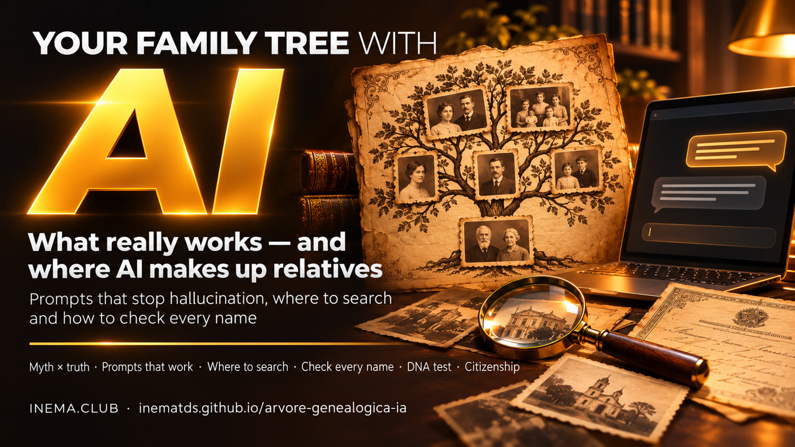

# 🌳 AI Genealogy Tree

**🇧🇷 [Português](README.md) · 🇺🇸 [English](README.en.md) · 🇪🇸 [Español](README.es.md)**

[](https://inematds.github.io/arvore-genealogica-ia/guia/en/)

## What it is

This is a free guide to building your family tree using an AI chat (ChatGPT, Claude, Gemini) the right way. It explains what the viral video “ChatGPT finds your relatives” gets right and where AI makes up people. It includes 8 ready-to-use prompts that require AI to show its evidence, a list of archives where you can actually search, and a checklist for verifying each name. All you need is an AI chat and, if you want a drawn tree, Python 3.

## 📖 User guide

Complete guide (landing page + step-by-step instructions): **https://inematds.github.io/arvore-genealogica-ia/guia/en/**

🎬 Video (what works and where AI invents relatives, in Portuguese): **https://inematds.github.io/arvore-genealogica-ia/videos/**

## The rule

> **AI isn’t the detective. It’s your assistant. The document is what confirms things.**

Every new person added to the tree needs a record with **name + date + place** that you opened yourself. Everything else is marked as a **HYPOTHESIS**.

## What’s included

> The prompts and docs in `prompts/` and `docs/` are in Portuguese (the guide page has every prompt in English).

| Folder | What it is |
|---|---|
| [`docs/mito-verdade.md`](docs/mito-verdade.md) | The 4 requests from the viral video, one by one: what works and why AI makes up relatives. |
| [`prompts/`](prompts/) | 8 ready-to-use prompts: interview, table, read an old document, where to search, research with evidence, audit a response, citizenship, visual tree. |
| [`docs/onde-pesquisar.md`](docs/onde-pesquisar.md) | Real archives: FamilySearch, registry office (full record), parishes, archives, Immigration Museum, Hemeroteca, Antenati, Digitarq, Matricula, DNA. |
| [`docs/checklist-conferencia.md`](docs/checklist-conferencia.md) | What to check before adding someone to the tree, and signs of fabrication. |
| [`scripts/arvore.py`](scripts/arvore.py) | Turns the CSV table into a visual tree (HTML), with automatic verification. |
| [`modelos/people.csv`](modelos/people.csv) | Sample table in English (fictional family); PT: `pessoas.csv`, ES: `personas.csv`. |

## The process, from start to finish

| # | Step | Command / file | Who |
|---|---|---|---|
| 1 | Interview the family and gather papers from home | [`prompts/01-entrevista-familia.md`](prompts/01-entrevista-familia.md) | 🧠 you + AI chat |
| 2 | Organize everything in a table with `source` and `status` | prompt 2 on the [guide](https://inematds.github.io/arvore-genealogica-ia/guia/en/#guia) → `my-family.csv` | 🧠 you + AI chat |
| 3 | Transcribe and translate old documents (photo) | [`prompts/03-ler-documento-antigo.md`](prompts/03-ler-documento-antigo.md) | 🧠 you + AI chat |
| 4 | Find out where to search and open each link | [`prompts/04-onde-procurar.md`](prompts/04-onde-procurar.md) + [`docs/onde-pesquisar.md`](docs/onde-pesquisar.md) | 🧠 you |
| 5 | Research with evidence (direct link, or HYPOTHESIS) | [`prompts/05-pesquisa-com-prova.md`](prompts/05-pesquisa-com-prova.md) | 🧠 you + chat with browsing |
| 6 | Audit lists already provided by AI (new chat) | [`prompts/06-auditar-resposta.md`](prompts/06-auditar-resposta.md) | 🧠 you + AI chat |
| 7 | Verify each new person | [`docs/checklist-conferencia.md`](docs/checklist-conferencia.md) | 🧠 you |
| 8 | (Optional) list of documents for citizenship | [`prompts/07-cidadania-documentos.md`](prompts/07-cidadania-documentos.md) → consulate | 🧠 you |
| 9 | Draw the tree with automatic verification | `python3 scripts/arvore.py my-family.csv --output my-tree.html` | ⚙️ script |

## Run the script

```bash
git clone https://github.com/inematds/arvore-genealogica-ia
cd arvore-genealogica-ia
python3 scripts/arvore.py modelos/people.csv --output example.html         # fictional family
python3 scripts/arvore.py my-family.csv --only-confirmed --output only-proof.html
python3 -m unittest discover tests                                        # 15 tests
py scripts\arvore.py my-family.csv --output my-tree.html                 # Windows (PowerShell)
```

The script also reads English columns (`id,name,birth,place_of_birth,father_id,mother_id,source,status,note`, `CONFIRMED`/`HYPOTHESIS`) and answers in English — see `modelos/people.csv`.

The script has no dependencies (only Python 3); the generated HTML needs internet access to render. It warns when:
- a person is **CONFIRMED without a source**, or with a generic source (just the website address), and downgrades them to HYPOTHESIS;
- a `father_id`/`mother_id` does not exist in the table;
- the father or mother would be younger than 12 or older than 70 when the child was born.

## Citizenship: a note

The rules have changed. Italy limited citizenship by descent in 2025 (Decree-Law 36/2025, converted into Law 74/2025), and Portugal changed its Nationality Law in 2025–2026, with parts challenged in the Constitutional Court (information verified in November 2026). This guide does not provide legal advice: check with the consulate or a specialist attorney.

---

Open and free content · [INEMA.CLUB](https://inema.club)
